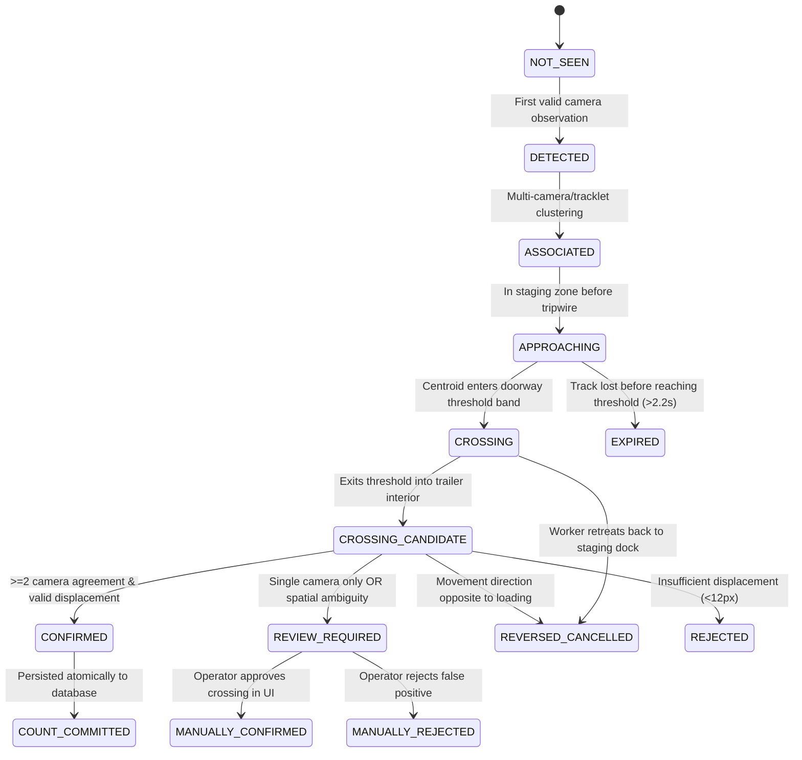

# Phase 2 — Event State Machine & Transition Rules

## 1. Executive Summary

This document specifies the deterministic state machine governing physical cartons and crossing events in the `carton-counter` multi-camera consensus engine (`CartonCrossingStateMachine`).

The state machine enforces the primary operational invariant:
> **One physical carton crossing the doorway threshold produces exactly one confirmed count transition, with all decisions logged via auditable reason codes.**

---

## 2. Event Lifecycle & State Definitions

### Detailed State Descriptions
1. **NOT_SEEN / UNCONFIRMED:** Initial state prior to any carton detection.
2. **DETECTED:** Raw neural network segmentation detection in an individual camera frame.
3. **ASSOCIATED:** Grouped across camera views by `CrossCameraAssociator` into a `PhysicalCarton`.
4. **APPROACHING / OBSERVED:** Carton moving within the staging corridor before the red tripwire line ($X < X_{\text{line}} - \text{margin}$).
5. **CROSSING:** Carton centroid actively traversing the doorway threshold band ($X \in [X_{\text{line}} - \text{margin}, X_{\text{line}} + \text{margin}]$).
6. **CROSSING_CANDIDATE / CROSSED:** Carton centroid emerges into the truck interior zone ($X > X_{\text{line}} + \text{margin}$).
7. **CONFIRMED / COUNT_COMMITTED:** Consensus criteria satisfied ($\ge 2$ camera views, valid direction, displacement $\ge 12\text{ px}$). Fired once into database.
8. **REVIEW_REQUIRED:** Observation quarantined due to single-camera visibility, severe occlusion, or cluster ambiguity. Excluded from `confirmed_count`.
9. **REVERSED_CANCELLED:** Worker retreated or crossed in opposite direction (`OUT` during `IN` loading). Cancelled with zero count change.
10. **REJECTED:** Discarded due to lack of motion (stationary box placed near line).
11. **EXPIRED:** Track timed out without completing crossing.

---

## 3. Transition Rules & Invariant Enforcement

| Source State | Target State | Trigger / Condition | Action / Result | Reason Code |
|---|---|---|---|---|
| `NOT_SEEN` | `DETECTED` | Valid YOLO segmentation mask ($conf \ge 0.25$) | Instantiate camera tracklet | `RAW_DETECTION_ACQUIRED` |
| `DETECTED` | `ASSOCIATED` | Dock homography or temporal window match | Link to `PhysicalCarton` | `CROSS_CAM_LINKED` |
| `ASSOCIATED` | `APPROACHING` | Position classified in `"before"` zone | Record approach history | `APPROACH_ZONE_ENTERED` |
| `APPROACHING` | `CROSSING` | Centroid enters hysteresis deadband | Await emergence | `THRESHOLD_BAND_ENTERED` |
| `CROSSING` | `CROSSING_CANDIDATE` | Centroid emerges in `"after"` zone | Validate motion vector | `THRESHOLD_TRAVERSED` |
| `CROSSING_CANDIDATE` | `CONFIRMED` | Consensus: $\ge 2$ cameras agree on direction | Emit `CommittedCrossingEvent` (+1) | `MULTI_CAM_UNANIMOUS` / `TWO_CAM_AGREEMENT` |
| `CROSSING_CANDIDATE` | `REVIEW_REQUIRED` | Single camera observation only | Quarantine in review queue | `SINGLE_CAM_HOLD_REVIEW` |
| `CROSSING_CANDIDATE` | `REVIEW_REQUIRED` | Multiple equidistant tracklets | Quarantine in review queue | `SPATIAL_CLUSTER_AMBIGUITY` |
| `CROSSING_CANDIDATE` | `REVERSED_CANCELLED` | Direction opposite to `required_direction` | Cancel candidate (0 count) | `DIRECTION_OPPOSITE_CANCELLED` |
| `CROSSING_CANDIDATE` | `REJECTED` | Total displacement $< 12.0\text{ px}$ | Suppress static noise | `MIN_DISPLACEMENT_NOT_MET` |
| `CROSSING` | `REVERSED_CANCELLED` | Trajectory retreats to `"before"` zone | Cancel candidate (0 count) | `WORKER_RETREAT_CANCELLED` |
| `CONFIRMED` | `COUNT_COMMITTED` | Written to durable SQLite WAL database | Increment durable count | `DB_TRANSACTION_COMMITTED` |
| `REVIEW_REQUIRED` | `MANUALLY_CONFIRMED` | Operator review API approval | Update DB state to confirmed (+1) | `OPERATOR_OVERRIDE_CONFIRMED` |
| `REVIEW_REQUIRED` | `MANUALLY_REJECTED` | Operator review API rejection | Update DB state to rejected (0) | `OPERATOR_OVERRIDE_REJECTED` |

---

## 4. Guard Invariants

1. **No Direct Confirmation from Isolated Detection:** A raw bounding box cannot jump directly to `CONFIRMED`. It must transition through `ASSOCIATED` $\to$ `APPROACHING` $\to$ `CROSSING` $\to$ `CROSSING_CANDIDATE`.
2. **Direction Validation:** Every crossing requires vector displacement in the configured loading direction. Cartons carried backwards produce `REVERSED_CANCELLED` with 0 count change.
3. **Repeated Observation Deduplication:** Once a `PhysicalCarton` has reached `COUNT_COMMITTED`, subsequent detections or tracklets associated with that carton absorb as corroboration, updating `participating_cameras` without creating a second count.
4. **Invalid Transition Protection:** Illegal transitions (e.g. `NOT_SEEN` $\to$ `CONFIRMED`, or `REVERSED_CANCELLED` $\to$ `CONFIRMED`) raise invalid transition errors or are rejected by the state machine.
