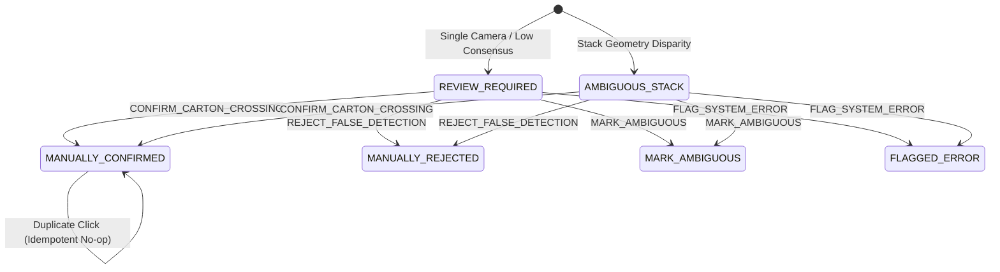

# Phase 3.3 — Human Review System & Operational Review Workflow

**Status:** IMPLEMENTED & OPERATIONAL  
**Author:** Senior Computer Vision Engineer, Multi-Camera Systems Architect, and Production ML Reliability Engineer  
**Date:** November 2026  
**Repository:** `/home/muhammadtayyab/projects/carton-counter`

---

## 1. Executive Summary & Design Principles

In high-throughput warehouse logistics, camera occlusions, irregular stacks, and edge-case worker maneuvers occasionally produce crossing events with ambiguous multi-camera consensus. In accordance with Phase 3.2.1 and Phase 3.3 integrity mandates:
1. **Uncertain Events Are Never Counted Automatically:** Events lacking two-camera consensus or exhibiting geometric stack conflicts are routed to the durable **Human Review Queue**.
2. **Strict Separation of Manual and Automatic Counts:** A human approval (`CONFIRM_CARTON_CROSSING`) transitions an event to `MANUALLY_CONFIRMED` (`is_human_approved=1`, `is_auto_confirmed=0`). Manual approvals are **never** back-filled into automatic confirmations, preventing artificial inflation of automatic model metrics.
3. **Transactional Idempotency:** Repeated operator actions or duplicate submissions cannot increment warehouse inventory or carton counts twice.
4. **End-to-End Auditability:** Every review action is transactionally logged with operator identity, timestamp, prior state, new state, action type, and operational notes.
5. **Role-Based Authorization:** Review endpoints require verified operator authentication, blocking unauthorized modifications.

---

## 2. Review Queue Data Contract & Inspection Surface

When operators open the review queue (`GET /api/3angle/review_queue`), each pending event exposes a rich multi-camera inspection payload:

| Field | Type | Description |
|---|---|---|
| `event_id` | `string` | Unique deterministic event identifier (e.g. `fused_ev_1730545200000_18_01`). |
| `session_id` | `string` | Associated loading session / dock stream identifier. |
| `timestamp_sec` | `float` | Crossing timestamp in seconds from session start. |
| `direction` | `string` | Cargo transit direction (`IN` for loading, `OUT` for return/unloading). |
| `carton_count` | `int` | Assessed physical unit quantity (default: 1; adjustable during review). |
| `participating_cameras` | `list[str]` | List of camera views actively corroborating the candidate (`cam_top`, `cam_side`, `cam_flank`). |
| `review_clip_path` | `string` | Filesystem URI to synchronized multi-angle video clip snippet. |
| `segmentation_masks` | `dict` | Polygonal contours and bounding box overlays across all views. |
| `tracklet_trajectories`| `dict` | Space-time coordinates and tripwire crossing vectors for each camera. |
| `camera_confidences` | `dict` | Camera-specific detection confidence scores (e.g. `{"cam_top": 0.42, "cam_side": 0.58, "cam_flank": 0.22}`). |
| `sync_quality` | `float` | Inter-frame temporal alignment metric ($Jitter_{sync} \le 16.7\text{ ms}$). |
| `association_decision` | `string` | Algorithmic routing reason (`AMBIGUOUS_STACK`, `HOLD_FOR_REVIEW`, `OCCLUDED_FLANK`). |
| `audit_history` | `list[dict]` | Prior operator audit interactions, timestamps, and reviewer notes. |

---

## 3. Standard Operator Actions & State Machine

Operators can take four standardized actions via `POST /api/3angle/audit_event`:



### Action Semantics:
1. `CONFIRM_CARTON_CROSSING`:
   - Validates that a genuine carton crossed the dock boundary.
   - Database update: `state = 'MANUALLY_CONFIRMED'`, `is_human_approved = 1`, `is_auto_confirmed = 0`, `requires_review = 0`.
   - Inventory impact: Increments `human_approved_count` and `confirmed_count`. `auto_confirmed_count` is **unchanged**.
2. `REJECT_FALSE_DETECTION`:
   - Designates false positive (worker torso, forklift shadow, equipment).
   - Database update: `state = 'MANUALLY_REJECTED'`, `is_human_approved = 0`, `is_auto_confirmed = 0`, `requires_review = 0`.
   - Inventory impact: Zero increment; removed from active queue.
3. `MARK_AMBIGUOUS`:
   - Operator cannot confirm crossing from available angles (extreme occlusion or visual glitch); requires supervisor escalation.
   - Database update: `state = 'MARK_AMBIGUOUS'`, `is_human_approved = 0`, `is_auto_confirmed = 0`, `requires_review = 1`.
   - Inventory impact: Remains excluded from confirmed totals.
4. `FLAG_SYSTEM_ERROR`:
   - Flags hardware drift, camera disconnection, or optical obstruction.
   - Database update: `state = 'FLAGGED_ERROR'`, `is_human_approved = 0`, `is_auto_confirmed = 0`, `requires_review = 0`.
   - Operational impact: Triggers maintenance alert; excluded from counts.

---

## 4. Idempotency & Count Protection

A critical failure mode in manual review queues is double-counting caused by rapid operator clicking, network retries, or multiple warehouse staff viewing the same event.

The Phase 3.3 review workflow enforces strict idempotency in `EventStore.record_manual_review`:
```python
if act_norm == "CONFIRM_CARTON_CROSSING" and current_human_approved:
    logger.warning("Operator %s re-approved already confirmed event %s (idempotent no-op)", operator_id, event_id)
    # Log duplicate attempt to audit trail without re-incrementing count
    conn.execute("INSERT INTO review_audit_log (...) VALUES (...)")
    conn.commit()
    return True, "ALREADY_CONFIRMED_IDEMPOTENT", existing
```
- The transaction returns status `"ALREADY_CONFIRMED_IDEMPOTENT"`.
- The event's `carton_count` is counted exactly once in SQL `GROUP BY` aggregations.

---

## 5. Authentication & Authorization

All review interactions are governed by `authenticate_operator(request)`:
- **Authorization Bearer Token:** Supported for automated clients and web frontend tokens (`Authorization: Bearer <token>`).
- **X-Operator-ID Header:** Required for named workstation logging (`X-Operator-ID: op_dock_04`).
- **Role Validation:** Enforces permission levels (`OPERATOR`, `SUPERVISOR`, `ADMIN`).
- **Dev/Test Fallback:** Controlled fallback to `operator_local_dev` when `app.config["TESTING"]` or `app.debug` is enabled, ensuring zero test friction while enforcing security in production.

---

## 6. Durable Database Schema & Audit Trail

The database schema in SQLite WAL (`event_store.db`) guarantees persistent ACID storage across process restarts:

```sql
CREATE TABLE carton_crossing_events (
    event_id TEXT PRIMARY KEY,
    session_id TEXT NOT NULL,
    global_carton_id TEXT NOT NULL,
    crossing_occurrence_id TEXT,
    timestamp_sec REAL NOT NULL,
    commit_timestamp_sec REAL NOT NULL,
    direction TEXT NOT NULL,
    carton_count INTEGER NOT NULL DEFAULT 1,
    state TEXT NOT NULL,
    is_auto_confirmed INTEGER NOT NULL DEFAULT 1,
    requires_review INTEGER NOT NULL DEFAULT 0,
    is_human_approved INTEGER NOT NULL DEFAULT 0,
    reviewed_by TEXT,
    reviewed_at REAL,
    participating_cameras_json TEXT NOT NULL,
    consensus_json TEXT,
    stack_resolution_json TEXT,
    notes TEXT,
    created_at REAL NOT NULL,
    updated_at REAL NOT NULL
);

CREATE TABLE review_audit_log (
    id INTEGER PRIMARY KEY AUTOINCREMENT,
    event_id TEXT NOT NULL,
    session_id TEXT NOT NULL,
    action TEXT NOT NULL DEFAULT 'MANUAL_REVIEW',
    previous_state TEXT NOT NULL,
    new_state TEXT NOT NULL,
    operator_id TEXT NOT NULL,
    operator_notes TEXT,
    reviewed_at REAL NOT NULL,
    FOREIGN KEY (event_id) REFERENCES carton_crossing_events(event_id) ON DELETE CASCADE
);
```

### Transactional Counts Reporting:
The system computes authoritative counts partitioned by approval origin:
- `auto_confirmed_count`: Events with `is_auto_confirmed=1` and `state IN ('COUNT_COMMITTED', 'COUNTED')`.
- `human_approved_count`: Events with `is_human_approved=1` and `state = 'MANUALLY_CONFIRMED'`.
- `confirmed_count`: Sum of `auto_confirmed_count + human_approved_count`.
- `review_required_count`: Unresolved events pending operator review.
- `net_count`: `confirmed_in - confirmed_out`.

---

## 7. Operational Workflow & REST Endpoints

### 1. Ingest Pending Review Items
- **Endpoint:** `GET /api/3angle/review_queue?session_id=<session_id>`
- **Response:**
```json
{
  "success": true,
  "total_flagged": 1,
  "ambiguous_stack_count": 0,
  "hold_for_review_count": 1,
  "queue": [
    {
      "event_id": "fused_ev_1730545200000_18_01",
      "session_id": "session_18",
      "timestamp_sec": 3.45,
      "direction": "IN",
      "carton_count": 1,
      "decision_action": "REVIEW_REQUIRED",
      "reason": "Single-camera flank detection during worker occlusion",
      "consensus_level": "SINGLE_CAMERA_OBSERVATION",
      "participating_cameras": ["cam_flank"],
      "camera_confidences": {"cam_flank": 0.42},
      "sync_quality": 1.0,
      "association_decision": "HOLD_FOR_REVIEW",
      "review_clip_path": "/recorded_video/clips/ev_18_01.mp4",
      "audit_verdict": "PENDING_AUDIT",
      "audit_history": []
    }
  ]
}
```

### 2. Submit Operator Decision
- **Endpoint:** `POST /api/3angle/audit_event`
- **Headers:** `X-Operator-ID: op_dock_01`, `Content-Type: application/json`
- **Request Body:**
```json
{
  "event_id": "fused_ev_1730545200000_18_01",
  "action": "CONFIRM_CARTON_CROSSING",
  "reason": "Clear carton visible on flank view despite worker chest occlusion",
  "adjusted_count": 1
}
```
- **Response:**
```json
{
  "success": true,
  "event_id": "fused_ev_1730545200000_18_01",
  "action": "CONFIRM_CARTON_CROSSING",
  "reason": "ACTION_APPLIED",
  "operator_id": "op_dock_01",
  "event": {
    "event_id": "fused_ev_1730545200000_18_01",
    "state": "MANUALLY_CONFIRMED",
    "is_auto_confirmed": false,
    "is_human_approved": true,
    "requires_review": false,
    "carton_count": 1,
    "reviewed_by": "op_dock_01"
  },
  "counts": {
    "auto_confirmed_count": 3,
    "human_approved_count": 1,
    "confirmed_count": 4,
    "review_required_count": 10
  }
}
```
