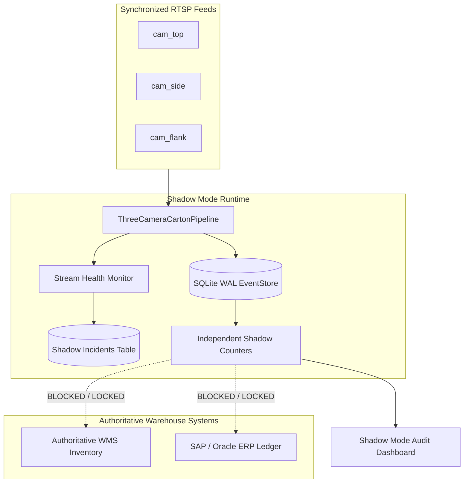

# Phase 3.3 — Operational Shadow Mode Deployment

**Status:** IMPLEMENTED & DEPLOYED  
**Author:** Senior Computer Vision Engineer, Multi-Camera Systems Architect, and Production ML Reliability Engineer  
**Date:** November 2026  
**Repository:** `/home/muhammadtayyab/projects/carton-counter`  
**Component:** `apps/truck_loading_detection/three_camera_system/shadow_mode.py`

---

## 1. Executive Summary & Purpose

Before autonomous multi-camera computer vision is trusted to drive automated inventory updates, it must prove itself in **Operational Shadow Mode**.

In Shadow Mode:
1. The vision system ingests live multi-camera RTSP/video feeds from loading docks in real time.
2. Full canonical carton detection, tracking, corridor gating, and two-camera consensus are executed normally.
3. Every crossing candidate and review event is persisted into the durable SQLite WAL `EventStore`.
4. **Zero Mutations to Authoritative Inventory:** Direct modifications to warehouse ERP, WMS, or TMS databases are strictly blocked.
5. Automated counts run side-by-side against human manifest/scale counts, logging discrepancies and synchronization anomalies for root-cause analysis.

---

## 2. Inventory Isolation Architecture

The shadow mode architecture wraps the core `ThreeCameraCartonPipeline` without spawning duplicate detection engines:



### Zero-Mutation Guarantee:
- `authoritative_inventory_locked = True`: Explicitly flags all shadow sessions in `shadow_session_manifest`.
- No ERP or WMS write adapters are instantiated or called by the shadow pipeline.
- Database records are partitioned by `session_id` (e.g. `shadow_dock_01_20261102`).

---

## 3. Independent Shadow Counters & Discrepancy Reconciliation

Shadow mode maintains five distinctly tracked metrics:

| Metric | Source | Definition & Calculation |
|---|---|---|
| **Human Physical Count** | Physical Manifest / Operator Input | The authoritative count recorded by the warehouse loading crew or pallet weighbridge. |
| **Automatic Confirmed Count** | Vision Consensus Engine | Events where $\ge 2$ cameras agreed and `is_auto_confirmed=1`. |
| **Human-Approved Count** | 1-Click Review Audit Queue | Events initially flagged `HOLD_FOR_REVIEW` and approved by an operator (`is_human_approved=1`). |
| **System Total Confirmed** | Combined Verified Total | `automatic_confirmed_count + human_approved_count`. |
| **Unresolved Review Count** | Active Review Queue | Events currently pending manual operator inspection. |
| **Discrepancy Count** | Reconciliation Delta | $\| \text{Human Physical Count} - \text{System Total Confirmed} \|$. |

If `discrepancy_count > 0` after session completion, a structured incident is automatically logged for supervisor investigation.

---

## 4. Real-Time Stream Health & Incident Logging

The `ShadowStreamHealth` subsystem continuously monitors physical camera metrics:
- **Dropped Frame Tracker:** Detects network packet loss or hardware decoder lag. Every 50 dropped frames triggers a `CAMERA_FRAME_DROP` warning.
- **Synchronization Jitter Monitor:** Compares hardware capture timestamps across cameras. If inter-frame drift exceeds $33.3\text{ ms}$ (1 full frame at 30 FPS), a `SYNC_JITTER_EXCEEDED` alert is logged.
- **Processing FPS & Latency:** Real-time throughput is tracked per synchronized bundle to detect resource exhaustion.

### Incident Taxonomy:
All incidents are transactionally recorded in `shadow_incidents`:
```sql
CREATE TABLE shadow_incidents (
    id INTEGER PRIMARY KEY AUTOINCREMENT,
    incident_id TEXT UNIQUE NOT NULL,
    session_id TEXT NOT NULL,
    incident_type TEXT NOT NULL,
    severity TEXT NOT NULL,
    timestamp_sec REAL NOT NULL,
    description TEXT NOT NULL,
    metadata_json TEXT NOT NULL
);
```

Common Incident Types:
- `SYNC_JITTER_EXCEEDED`: Optical timestamp alignment drifted beyond acceptable tolerance.
- `CAMERA_FRAME_DROP`: Loss of RTSP frame packets from dock cameras.
- `COUNT_DISCREPANCY`: System count deviated from manifest physical count.
- `RESTART_RECOVERY`: Application process crashed or restarted, triggering state recovery from WAL.

---

## 5. Crash Recovery & Application Restart

If the server host reboots or the container restarts:
1. `ShadowModeManager.recover_session_state()` opens the durable SQLite WAL database.
2. Ingests all previously committed carton crossings and occurrence IDs.
3. Restores the session manifest and human physical target count.
4. Restores historical incident logs.
5. Emits a `RESTART_RECOVERY` incident log detailing restored metrics.
6. Processing resumes without generating duplicate events or losing historical counts.

---

## 6. Shadow Mode REST APIs

### 1. Inquire Shadow Operating Status
- **Endpoint:** `GET /api/shadow/status?session_id=<session_id>`
- **Response:**
```json
{
  "success": true,
  "mode": "SHADOW_MODE",
  "authoritative_inventory_locked": true,
  "session_id": "shadow_dock_01",
  "health": {
    "total_frames_ingested": 817,
    "dropped_frames": 0,
    "max_sync_jitter_ms": 14.2,
    "current_sync_jitter_ms": 8.1,
    "processing_fps": 28.4,
    "average_latency_ms": 35.2,
    "incidents_logged": 0
  },
  "incidents_count": 0
}
```

### 2. Side-by-Side Count Comparison
- **Endpoint:** `GET /api/shadow/counts?session_id=<session_id>`
- **Response:**
```json
{
  "success": true,
  "shadow_summary": {
    "session_id": "shadow_dock_01",
    "authoritative_inventory_locked": true,
    "human_physical_count": 14,
    "automatic_confirmed_count": 3,
    "human_approved_count": 11,
    "system_total_confirmed": 14,
    "unresolved_review_count": 0,
    "discrepancy_count": 0,
    "discrepancy_rate_pct": 0.0
  }
}
```

### 3. Register Physical Ground Truth Count
- **Endpoint:** `POST /api/shadow/compare`
- **Request Body:**
```json
{
  "session_id": "shadow_dock_01",
  "human_physical_count": 14
}
```

### 4. Query Incident Audit Trail
- **Endpoint:** `GET /api/shadow/incidents?session_id=<session_id>`
